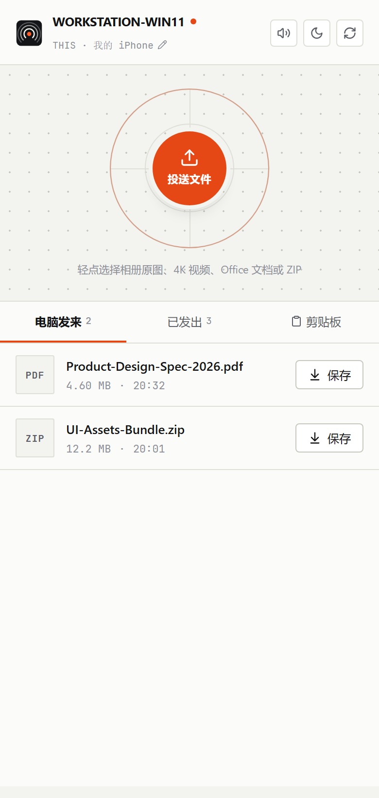
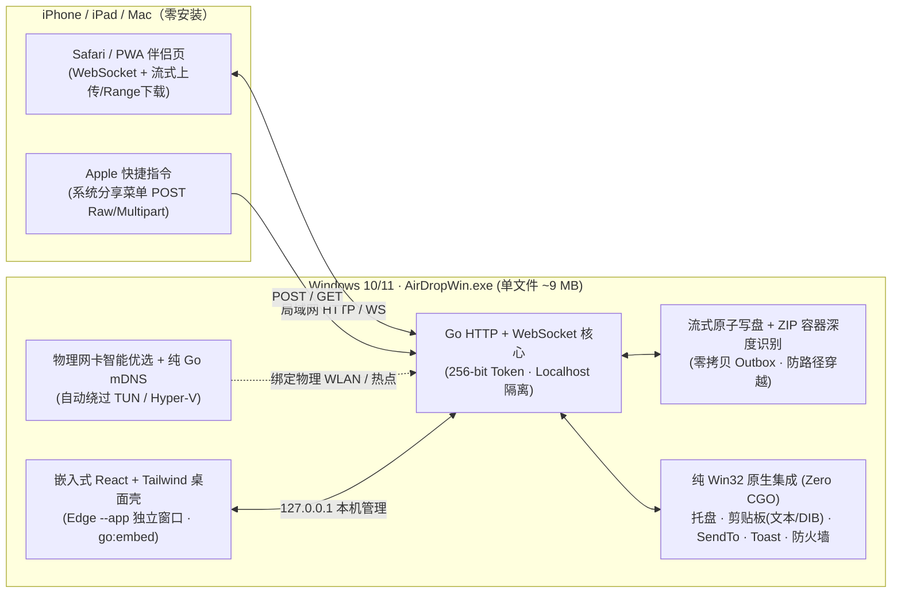

<div align="center">


# AirDropWin · 隔空传

**专为 Windows ↔ iPhone / iPad / Mac 打造的局域网高速「类隔空投送」工具**  
**纯 Go 单文件原生程序（~9 MB · 零 CGO · 零外部依赖）｜手机与 Mac 端免装 App**

[](https://github.com/sup-lh/airdrop-win/releases)
[-E64815?style=flat-square)](#快速上手3-步开传)
[-00ADD8?style=flat-square)](go.mod)
[](LICENSE)

[下载最新版本 (Releases)](https://github.com/sup-lh/airdrop-win/releases) · [界面预览](#界面与设计预览) · [快速上手](#快速上手3-步开传) · [苹果快捷指令配置](#苹果快捷指令5-行积木直传) · [源码构建](#从源码构建)

</div>

---

## 界面与设计预览

AirDropWin 采用 **瑞士 `1px` 细线网格 × 工业仪表美学**（严格遵守 `85% 沉静底色 / 10% 结构字墨 / 5% 信号朱红焦点` 色彩纪律），支持 **浅色暖陶瓷** 与 **深色哑光石墨** 双主题无缝切换，全视口贴合桌面端，久看不刺眼。

### 桌面端 · 深色石墨（极坐标实时雷达 + 在线设备环绕）


### 桌面端 · 浅色暖陶瓷（首次扫码即连 + 传输明细台账）


### 局域网网页端（Mac / 另一台电脑访问）＆ 手机端（iPhone 免装 PWA）

| iPhone 零安装伴侣端（克制 5% 撞色 · 极简口袋仪表） | Mac / 电脑浏览器访问局域网地址（自动展开 `1px` 双栏工作台） |
| :---: | :---: |
|  |  |

### 苹果快捷指令蓝图 ＆ 实时诊断终端


---

## 为什么做 AirDropWin？

Windows 自带无线网卡驱动不开放苹果私有 AWDL 底层帧注入，而市面上常见局域网替代工具又各有痛点。AirDropWin 专门针对真实高频使用场景做了深度打磨：

| 对比维度 | **AirDropWin（本项目）** | LocalSend | PairDrop | AirDropPlus |
| :--- | :--- | :--- | :--- | :--- |
| **iPhone / Mac 免装 App** | ✅ 扫码即连 PWA + 苹果快捷指令 | ❌ 需两端都装 App | ✅ 仅浏览器标签页 | ✅ 仅快捷指令 |
| **单文件轻量体积** | ✅ **~9 MB 纯 Go 原生 `.exe`** | ~30+ MB Flutter | 依赖浏览器/中继 | Python 打包体积大 |
| **绕过 Clash/Meta TUN & Hyper-V** | ✅ **自动识别物理 WLAN/热点网卡** | 易被 TUN 拦截组播 | 依赖外网信令 | 需折腾旧版 Bonjour |
| **双向剪贴板（含截图图片）** | ✅ **纯 Win32 文本 + `CF_DIB/PNG` 截图** | 仅文本 | 仅文本 | Python3.13/iOS26 报错 |
| **大文件 / 4K 视频 / Office 识别** | ✅ 流式落盘 + 深度识别 `.docx/.xlsx/.heic/.mov` | ✅ 支持 | iOS 大文件易崩 | 压缩包/大视频易失败 |
| **Windows 原生深度集成** | ✅ 托盘 + 右键「发送到」+ Win11 通知 + 一键防火墙 | 托盘 | ❌ 无 | 托盘 + 通知 |

---

## 核心特性

- **零安装双向极速互传**
  - **iPhone / Mac → Windows**：支持扫码网页多选发送（带实时百分比与 MB/s 速率环）与 **iOS/macOS 系统「分享菜单 → 快捷指令」直传**；后端纯流式写盘 + `.part` 原子重命名，不爆内存、不损文件。
  - **Windows → iPhone / Mac**：支持全窗口拖拽、原生多文件选择器（`Ctrl+O`），以及资源管理器右键 **「发送到 → 隔空传」**——**直接零拷贝读取磁盘原路径**，GB 级视频秒级入列，支持 HTTP Range 断点下载与中文 RFC 5987 文件名。
- **深度容器与魔数识别（无文件名也不乱后缀）**
  - 针对 iOS 快捷指令发送原始二进制体未带文件名的痛点，后端自动结合 MIME、文件头魔数与 ZIP 中央目录毫秒级检测，精准区分 **`.docx` / `.xlsx` / `.pptx` / `.pages` / `.key` / `.numbers` / `.epub` / `.apk` / `.zip` / `.heic` / `.mov` / `.mp4` / `.pdf` / `.7z` / `.rar`**。
  - 智能防呆：即使误将照片或文档发到剪贴板接口，也会自动转存为真实文件并异步写入图片剪贴板，彻底杜绝文本乱码与页面卡死。
- **双向剪贴板同步（文字 + 图片）**
  - 纯 Win32 API（零 CGO）读写 Windows 剪贴板，支持将 `Win+Shift+S` 截图或文字一键推送给手机/Mac（支持全局快捷键 **`Ctrl+V`** 秒推，也支持开启自动监听）。
  - 手机发来的照片/截图同时写入 `CF_DIB` 与 `PNG` 格式，电脑端直接 **`Ctrl+V`** 即可粘贴进微信、飞书、Office 或 Photoshop。
  - 适配 iOS Safari 纯 HTTP 局域网剪贴板复制兼容方案。
- **专为复杂 Windows 网络环境优化**
  - 自动过滤 `Clash / Mihomo / Meta / Wintun / Tailscale / Hyper-V / vEthernet / WSL / 198.18.x.x` 等虚拟代理网卡，优先锁定物理 Wi-Fi / 热点 / 有线网卡。
  - 内置纯 Go mDNS 广播（`hostname.local`），**无需安装 Apple Bonjour**。
  - 内置 **Windows 防火墙状态检测与 UAC 一键放行**（同时覆盖专用与公用 Wi-Fi 网络）。
- **100% 局域网隐私安全**
  - 零云服务器、零账号、零遥测，所有数据仅在本地局域网流转。
  - 256-bit 随机配对令牌鉴权，管理接口 `/api/local/*` 严格限定本机回环访问；支持随时一键重置令牌踢出旧设备，支持开启**原生 AirDrop 风格「接收前弹窗确认」**。

---

## 系统架构



---

## 快速上手（3 步开传）

1. **下载运行**：前往 [Releases](https://github.com/sup-lh/airdrop-win/releases) 下载 `AirDropWin.exe` 直接双击运行（无黑框，自动打开独立桌面窗口并驻留右下角托盘）。
2. **首次放行防火墙**：如果你的 Wi-Fi 在 Windows 中被标记为「公用网络」，点击界面左下角或「04 系统与网络」里的 **「一键放行」**（在 UAC 弹窗点「是」即可）。
3. **手机 / Mac 接入**：
   - **方式 A（推荐，最省事）**：用 iPhone 相机扫描桌面二维码即永久配对；在 Safari 点底部 **分享 → 添加到主屏幕**，即可像原生 App 一样使用。
   - **方式 B（系统分享菜单直传）**：切到桌面端 **`03 苹果快捷指令`**，按下方 5 行积木配置一次，即可在相册/文件里直接点「分享 → 发送到 Windows」。

---

## 苹果快捷指令（5 行积木直传）

打开桌面端 **`03 苹果快捷指令`** 复制你的专属 `01 POST` 上传链接，在 iPhone「快捷指令」App 新建指令、点底部 `ⓘ` 开启「在共享表单中显示」，拼出以下 5 行即可（Header 留空即可，自动识别原图、4K 视频、Word/Excel/PDF/ZIP）：

```text
01  接收来自 [共享表单] 的 [任意] 输入
02  对 [快捷指令输入] 中的每一项重复
03      获取 [http://<你的电脑IP>:53318/api/shortcut/upload?token=...] 的内容
          ▸ 方法：POST
          ▸ 请求体：文件
          ▸ 文件：[重复项目]
04  结束重复
05  显示通知 [已发送到 Windows]
```

> 若想同时保留原始文件名，可在「获取 URL 内容 → 头部」追加一行键 `X-Filename`、值选「重复项目 → 名称」。

---

## 快捷键与桌面集成

| 功能 / 快捷键 | 说明 |
| :--- | :--- |
| **`Ctrl + O`** | 唤起 Windows 原生多文件选择器，**零拷贝**共享给手机 / Mac |
| **`Ctrl + V`** | 任意时刻按下，立即将 Windows 剪贴板文字或 `Win+Shift+S` 截图推送给手机 / Mac |
| **`Esc`** | 快速关闭大图预览灯箱（Quick Look）或二维码弹窗 |
| **右键「发送到 → 隔空传」** | 在「04 系统与网络」一键开启，资源管理器右键任意文件直发 |
| **开机静默自启** | 写入当前用户启动项（无需管理员权限），开机安静驻留托盘 |

---

## 从源码构建

环境要求：**Go 1.22+**、**Node.js 20+**、**pnpm**（Windows 平台无需安装 GCC / MinGW，全程 `CGO_ENABLED=0`）。

```powershell
git clone https://github.com/sup-lh/airdrop-win.git
cd airdrop-win
.\build.ps1
```

构建完成后将在 `dist\` 目录生成：
- `dist\AirDropWin.exe`：Windows GUI 无黑框桌面托盘版
- `dist\AirDropWin-cli.exe`：带终端实时日志的调试版（支持 `--port`、`--no-tray`、`--no-open`、`--minimized`、`--send <files...>`）

---

## 项目结构

```text
airdrop-win/
├── cmd/airdrop-win/          # 入口、命令行参数与单实例 IPC 交接
├── internal/
│   ├── config/               # 持久化配置 (%APPDATA%\AirDropWin\config.json)
│   ├── network/              # 物理网卡评分过滤 (绕过 TUN/Hyper-V) + 纯 Go mDNS
│   ├── transfer/             # 流式原子写盘、ZIP/Office 深度识别、WebSocket Hub
│   ├── clipboard/            # 纯 Win32 API 双向文本 + CF_DIB/PNG 剪贴板
│   ├── winutil/              # 纯 Win32 托盘、文件对话框、SendTo、Toast、防火墙助手
│   └── server/               # HTTP/WS 路由、Localhost 隔离鉴权、苹果快捷指令接口
├── web/                      # React 19 + TypeScript + Tailwind v4 嵌入式双端前端
├── docs/images/              # README 高清实机截图
├── web_embed.go              # go:embed 静态资源打包入口
└── build.ps1                 # 一键构建脚本
```

---

## 开源协议

本项目基于 [MIT License](LICENSE) 开源，欢迎 Star、提 Issue 或提交 Pull Request！
